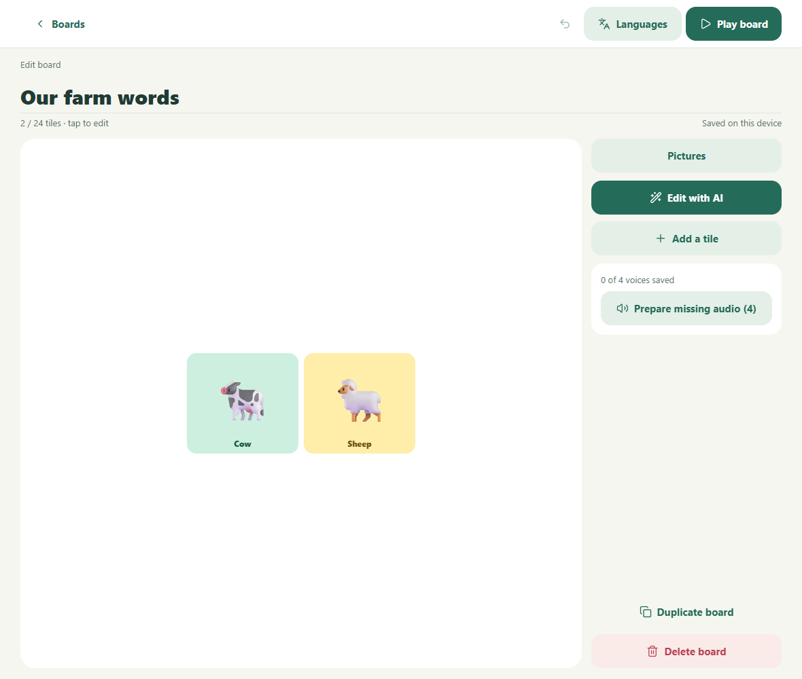
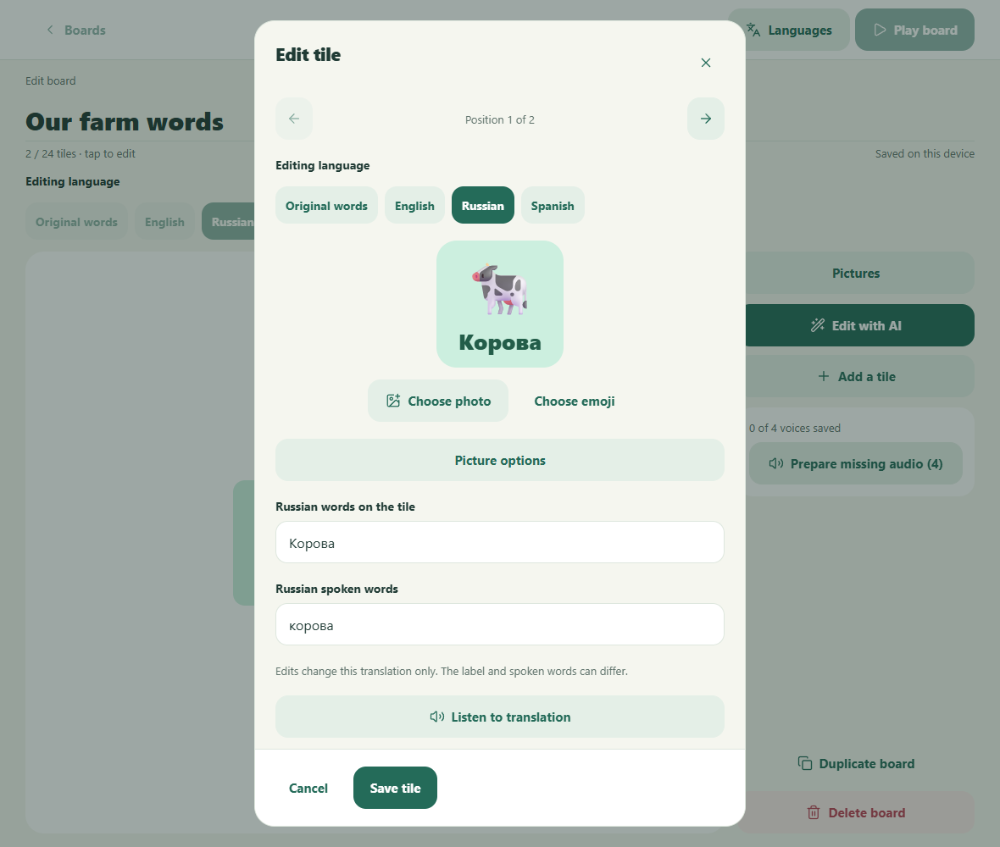

# Final issue32 evidence

Owner: Codex task 01a1140f-ccd2-765d-a393-3ad6dd4ec02b. This is a non-merged evidence ref in the authorized repository. Retain it through review and merge; cleanup requires the human's explicit retention decision. Never merge this ref into product history. Earlier artifacts, identities and the first publication snapshot are preserved unchanged under final/, initial/, and publication-initial/.

## Final source and behavior

Before: 7e8ab5993503419e5945c8f304ffab3a6fc91f56, actual direct parent PR36. After: a08a723d87cee4bbb3026f11b3fcfa8c63c6f2ce, final PR38 head. Grandparent PR34 remains b21d3ba7370c08468b868385ce9df3d875eee799 and ultimate master remains 1f0329052bd46b1e953c5adb5ad7e59ba2f2dcc4. Review #34 → #36 → #38.

Parents now see and edit the selected language in the board preview and primary card fields. Original English, other languages and fixed-language cards are preserved. Missing variants are blank; source changes retain saved words for review. Audio uses exact selected spoken text and language, with separate cache identities, delayed-result guards and failure/retry. Automatic translation and AI merges protect manual/legacy corrections; deliberate replacement has a separate draft-bound review. An AI source-language change that would shadow a protected saved translation is refused with an actionable message.

The original user report was not reproduced against their deployed build. Real parent captures establish the narrower verified behavior: board/main card fields remained English, while lower Russian translation fields already existed. These are genuine baseline observations, not reconstructed mockups.

## Matched Before/After

| Before | After |
| --- | --- |
|  |  |
|  |  |

The same saved Russian play selection, synthetic English/Russian/Spanish library, viewport1180×1000, scale1, light theme, locale/timezone and controlled starting clock were used. Both card views start at the Position row. Baseline-only [lower translation controls](review-fix/before-existing-translation-controls.png) make existing functionality explicit. Supplemental current-only states: [audio failure](review-fix/after-corrected-audio-failure.png), [stale review](review-fix/after-stale-correction.png), [phone browser](review-fix/after-phone-board.png), [replacement review](review-fix/after-ai-replacement-review.png), [source-collision refusal](review-fix/after-ai-source-collision.png). These are not claimed as matched pairs or native captures.

## Bound provenance and reproduction

[Manifest](review-fix/manifest.json), SHA-256 240f2955b99d138d9b3382762a97de7e33d3a47731597458236a860b2a9135a8, binds full source commits, exact server/web output hashes, actual listener PID, served JavaScript bytes, capture timestamps and all ten PNG hashes. [Harness](review-fix/capture-translations-review-fix.mjs), SHA-256 a384a520960365593670852e71186948cf8cce720379bdf16e32b43c18713fea; [fixture](review-fix/fixture.json), SHA-256 b80402905e37595eeaa1a9c013817e552a796fc06e75e99cca6b25f03e4ea34c. All nine prior represented states were recaptured from the final head and match previously inspected pixel bytes. The new refusal image was opened and visually inspected.

Windows ZBook, Node24.19.0 and installed Edge154.0.4258.62. Follow the isolated checkout/build setup in the retained [original reproduction record](README.md), but use the final After commit above, place the new harness beside those checkouts and run node capture-translations-review-fix.mjs. It writes translation-evidence-review-fix. The embedded machine-specific PowerShell path must be adapted and disclosed on another host. No package installation was performed. Service workers are blocked equally, device voices and providers are controlled, fullscreen is neutralized and clocks advance normally from the same epoch. No screenshot cropping, redaction or DOM hiding occurred.

## Validation and scope

[Current validation](validation-current.json): 231 unit tests, 116 passed (6.3m), release-contract checks, TypeScript, server/web builds and both native bundle exports passed. Current logs are checks/*-review-fix.log. Exact-head CI run37710438617 passed, including database integration. Maintained tests cover persistence, cancel/switch, original/other-language preservation, protected/stale/missing variants, delayed translation/audio, failure/retry, source-language collision, draft-bound replacement and parent transition/grid compatibility.

[Scope inventory](source-scope-current.json): both published commits and complete parent-to-final diff reviewed, 14 files (+512/−67), nine product plus five maintained regression files. No capture harnesses, logs, export inventories or transient evidence are in product history. Durable clone and other owners' worktrees remain intact.

Physical devices and emulators were not run; [native execution is deferred](https://github.com/MChartier/calibrate-health/issues/405#issuecomment-6041659686), and bundle exports are not device evidence. Live paid providers were not run. Actual GitHub page rendering is waived by [comment6022754087](https://github.com/MChartier/calibrate-health/issues/405#issuecomment-6022754087); independent genuine-pixel/provenance/access verification still belongs to QA. The coordinator owns Project, native closing association via GitHub Development sidebar, independent QA and readiness. Draft status is preserved.
