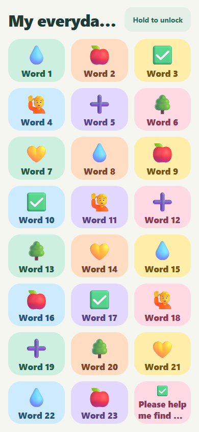
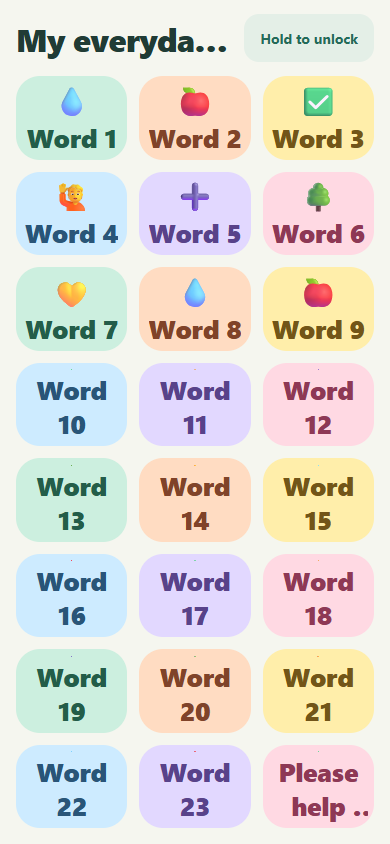

# Independent QA: PR34 / issue31

**Verdict: evidence-incomplete.** The requested default-size geometry works in the inspected browser states and the published scope is focused. The remaining blocker is the requested representative native/accessibility validation, especially larger text.

## Remaining finding F1

Issue31 requires larger text, images and controls to remain usable, and calls for representative native rotation/accessibility validation. No native device or emulator run, OS text scaling, TalkBack or VoiceOver evidence is available. The scoped human waiver covers only actual GitHub-page rendering.

A separate browser-only diagnostic increased card-label CSS fonts to150% at390x844 with24cards. The last picture frame shrank from25.5px to1.5px, and several pictures became visually negligible. This is a concrete risk signal, **not a native OS-scaling test or a proven native regression**; native adjustsFontSizeToFit can differ. Obtain native results at increased text sizes and screen-reader activation before certification; fix only demonstrated failures. If capability remains unavailable, route a scoped decision to the human.

| Default browser state | Synthetic150% label diagnostic (not native proof) |
| --- | --- |
|  |  |

## What passed

- Complete published history: one direct commit over actual master,12files,+331/-33. Seven product files,four maintained regression files,one design-contract note. Every path is mapped in [record.json](record.json). No sibling merges or temporary evidence add/delete churn. The small regional-language assertion correction is supported by a reproduced baseline failure and still checks ES-MX.
- Independently inspected all12 original image files across six matched pairs. Four-card landscape changes3+1 to2+2; portrait pixels are unchanged; seven-card rows/editor and tiny-window recovery are accurately presented.
- Verified all71 indexed retained artifacts; source SHAs,manifest/harness,image and synthetic fixture identities,19build files per side and server hashes. Independently loaded final App/index bundles matched the preserved hashes.
- Independent192 numerical size/count cases and20 actual rendered combinations passed:4,5,7,23,24cards across both specified tablet and phone orientations. Minimum observed side in those browser combinations was80.5px; all were in bounds and balanced.
- Browser rotation retained active/pending synthetic speech; stale gap contacts and parent holds canceled; keyboard activation selected the intended card. Tiny-window messaging recovered after resize. The24-card editor retained correct saved-card selection.
- Dense photo crop stayed invariant across all four viewports; local photo remained present after going offline and resizing; Russian accessible name and photo keyboard activation passed. This probe did not claim offline reload coverage; the maintained current-head full suite supplies that existing case.
- Current-head CI check112603976685/run37562895456 succeeded, including check and PostgreSQL integration. Retained222-unit,92-browser and iOS/Android JS export logs are consistent. No expensive unaffected suite was duplicated.

## Review and communication

Full issue/PR conversation,submitted reviews and inline threads were read and exact bodies rechecked. No actionable review finding is unresolved. The configured bot refused solely for quota in6029732188; the narrow human amendment applies, and no completed bot review is claimed. This QA independently inspected all changed code and relevant contracts.

The issue uses the required fixed template and points to the verified implementation task and PR; native closing association is present. The PR explains the actual base-state problem and final solution, provides a concise behavior argument and embeds three genuine pairs. It honestly identifies native limitations and the rendered-page waiver. Communication/scope pass; missing native evidence prevents readiness.

## Binding, ownership and retention

Exact head: b21d3ba7370c08468b868385ce9df3d875eee799. Actual target/merge-base: 1f0329052bd46b1e953c5adb5ad7e59ba2f2dcc4, MChartier/little-say master. No parent. Exact UTF8 PR-body SHA256: 1db382d779b4339a62acf59d5e1c0686ac1e9d9490bfeae6c814e74857702608. Full pins,amendments,feedback dispositions and evidence identities are in [record.json](record.json).

QA task01a1144e-7290-74f6-9f05-1ad82d3e2018 is independent of owner01a11405-db71-76ed-9ec6-44717ef3402a. Verified MCHARTIER_ZBOOK; isolated detached QA worktree and runtime; tracked source unchanged. Issue30 owner01a11406-66b3-71fb-a4cc-2aad6d51802c stays pinned to this exact parent. Route any correction through the coordinator to the existing31owner and invalidate affected30gates. No readiness or merge action taken.

This dedicated nonmerged QA evidence ref belongs to this QA task/coordinator and must be retained for the lifetime of issue31/PR34 and any dependent review receipts. Do not merge it into product history or delete it without coordinated evidence preservation. Historical implementation evidence and receipt identities are unchanged.
