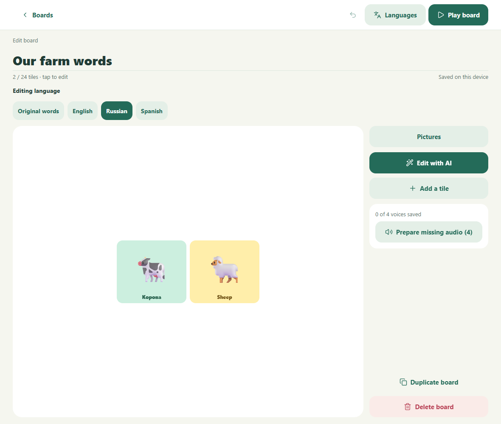
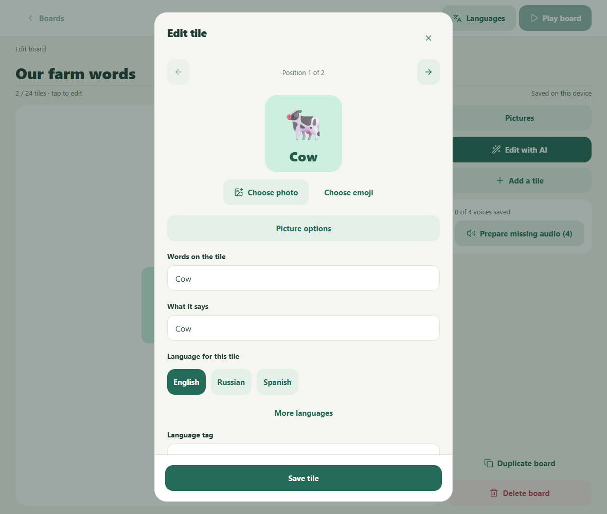

# Issue32 translation editing evidence

This non-merged evidence ref supports the draft implementation of [issue32](https://github.com/MChartier/little-say/issues/32). Owner: Codex task `01a1140f-ccd2-765d-a393-3ad6dd4ec02b`, coordinated through task `01a104fd-7529-7508-9800-5195b97f70e5`. Retain this ref and every recorded artifact through review and merge; cleanup requires the human's explicit retention decision. Do not merge this ref into a product branch.

## Baseline and outcome

The request reported that selecting another language changed speech while the editor stayed in English. Source inspection found separate lower translation fields already existed. The genuine parent capture confirms those fields, while the board preview and primary card fields still display source English. The final editor exposes Russian in those primary fields and its board preview, keeping the original English, Spanish and fixed-language card intact.

Before: `7e8ab5993503419e5945c8f304ffab3a6fc91f56` (direct parent PR36). After: `502c4de4c527b0f28fff4462f397f2d5b5f7167b`. Grandparent PR34: `b21d3ba7370c08468b868385ce9df3d875eee799`; ultimate master: `1f0329052bd46b1e953c5adb5ad7e59ba2f2dcc4`. Review order is #34, #36, then this child. The child changes no parent commits and is not independently mergeable.

## Matched application captures

Both sources ran in isolated clean checkouts on Windows with Edge 154.0.4258.62, viewport 1180×1000, scale 1, light theme, identical synthetic library and a controlled starting clock. Russian is the saved play language; play labels deliberately remain English. The editor language choice is independent of that play preference. No screenshots were edited, cropped or redacted.

| Before board | After board |
| --- | --- |
|  |  |

| Before card | After card |
| --- | --- |
|  |  |

Both card dialogs begin at the Position row. Before requires selecting its existing lower Russian control, then returning to the top; After inherits Russian from the board. [Baseline lower translation fields](final/before-existing-translation-controls.png) are shown separately so the comparison does not imply that all translation editing was absent.

Supplementary current-only states: [corrected words retained after audio failure](final/after-corrected-audio-failure.png), [stale saved words kept for review](final/after-stale-correction.png), [390×844 responsive browser](final/after-phone-board.png), and [explicit AI replacement review](final/after-ai-replacement-review.png). These are not claimed as matched Before/After pairs or native-device observations.

The author inspected the pixels of all canonical images directly or verified their bytes equal already inspected initial images. The board keeps fixed Sheep in English; Russian fields are visible and readable; failure leaves corrected words present; stale review offers a deliberate acceptance action; AI review shows saved and proposed wording separately.

## Exact provenance and reproduction

[Final manifest](final/manifest.json), SHA-256 `7f92ef3f52a711e6f755970f75a51f5083ea8f9d793d2c15a8f4039f1e00570e`, binds full source commits, dependency lock, every web export file, server bundle, running listener PID, served JavaScript response hashes, capture times, fixture and every PNG. It also binds [capture-translations.mjs](final/capture-translations.mjs), SHA-256 `b3a7618b4a80105479447f8e24cd210fe409e60055905fbdf496278080a96882`, and [fixture](final/fixture.json), SHA-256 `b80402905e37595eeaa1a9c013817e552a796fc06e75e99cca6b25f03e4ea34c`.

The retained script is the exact executed harness. To repeat, place it beside isolated checkouts named `little-say-before` and `little-say-translations`, with their pinned revisions and installed dependencies available. Build the parent server and web export, run the current `npm.cmd run check`, then `node capture-translations.mjs`. The script records and verifies actual served bundles against each checkout's build files before capture, uses separate ports 7521/7522 and fresh contexts, seeds IndexedDB, performs the recorded navigation, and closes its own server processes. It writes `translation-evidence-final` beside the checkouts. Its explicit PowerShell executable path must be adapted on a different machine and disclosed as a changed harness.

Normalization is explicit: service workers are blocked equally to exclude stale bundles/PWA notices; three synthetic device voices and mocked provider responses avoid paid inference; fullscreen requests are neutralized to preserve dimensions; the fixed starting clock advances normally. No compared application DOM is hidden or modified. [Playwright configuration](playwright.issue32.config.ts) uses a separate port 7520 and disables provider/database credentials.

The earlier framing attempt is retained verbatim under [initial](initial), including manifest SHA-256 `04278557c58098dcfc8a28ab1c614c3addbf919488b463f8ddaf0e5976f424e2` and its bound harness. Its card scroll positions differed; use the final matched pair above. No prior receipt or artifact identity was silently replaced.

## Behavioral validation

[Validation record](validation.json) and linked logs identify completed checks. `npm.cmd run check` passed 230 tests in 27 files, release-contract validation, TypeScript and server/web builds. The full installed-Edge browser suite passed 115 scenarios in 6.1 minutes. Both iOS and Android bundle exports passed.

The maintained tests exercise selected-language inheritance through dashboard and direct Play entry; label/speech correction, language switching, save/reopen/reload and Cancel; source and other-language preservation; missing and stale variants; manual/legacy protection during generation and AI proposals; explicit replacement approval tied to its draft; capacity refusal without eviction; revision conflict; delayed/cancelled translation responses; delayed audio bound to exact input; label-only audio reuse; audio failure/retry; and durable-save failure/retry. Parent transition, responsive-grid, speech and media regressions also passed. Test definitions are in the product commit, chiefly `tests/web/translationEditing.spec.ts` and `packages/core/src/translationEditing.test.ts`.

The first full browser run had two failures (new-card schema ordering and web selected-state semantics). The retained `checks/browser-resumed.log` records that run; the final source corrects both and `checks/browser-final.log` records the complete passing suite. This chronology is supporting evidence, not the PR's baseline comparison.

No live paid provider, physical device or emulator execution is claimed. Native execution is deferred for review readiness by [Calibrate405 comment6041659686](https://github.com/MChartier/calibrate-health/issues/405#issuecomment-6041659686). PostgreSQL integration is delegated to exact-head CI and must be read after publication. Actual GitHub page rendering is waived by [comment6022754087](https://github.com/MChartier/calibrate-health/issues/405#issuecomment-6022754087); genuine pixels and authenticated artifact access still require independent QA verification.

## Scope and retained issue history

[Complete child-history and merge-diff inventory](source-scope.json): one commit, 14 files, +487/−67; nine product files plus five maintained regression files. Every published child commit is focused. No one-off captures, harnesses, logs, export inventories or evidence are in the product history; no retained exception needs approval. The durable master clone and other worktrees remain untouched.

[Exact issue body before association update](issue32-before-association.md), SHA-256 `d50f6247db6ca9009f206cbd5a807fbb97a134237af4271b38af5f7a70c47a4e`, and [discussion](issue32-discussion-before-pr.json) preserve original requirements and the later implementation authorization. The product issue retains its first three sections; only implementation task/PR associations need changing. Coordinator owns Project and independent QA/readiness. No merge, release or deployment is authorized.
