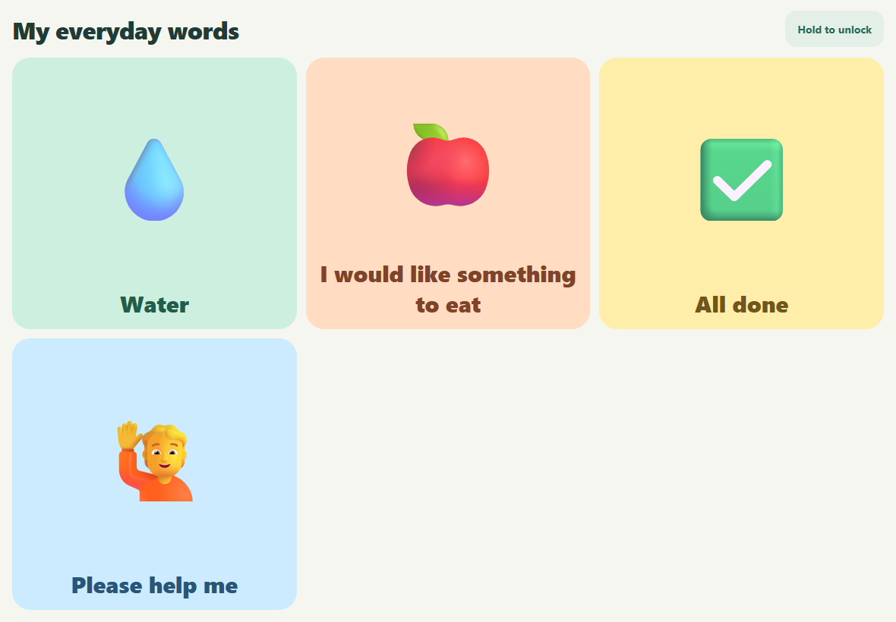
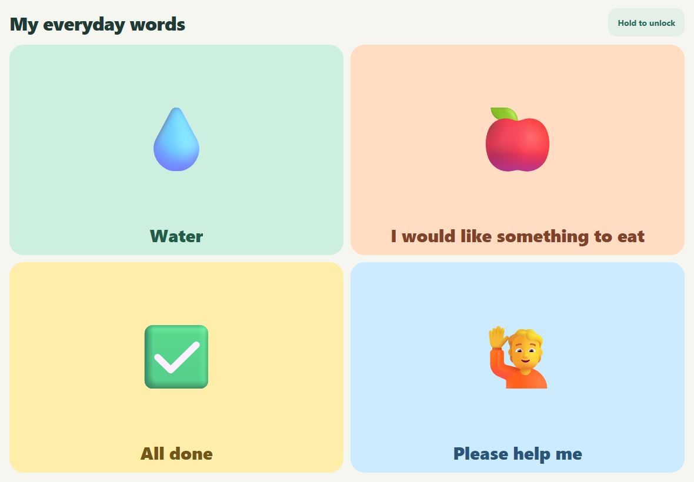
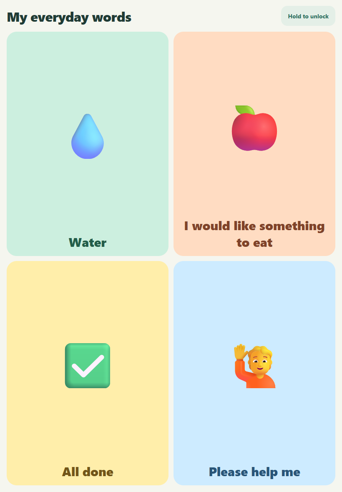
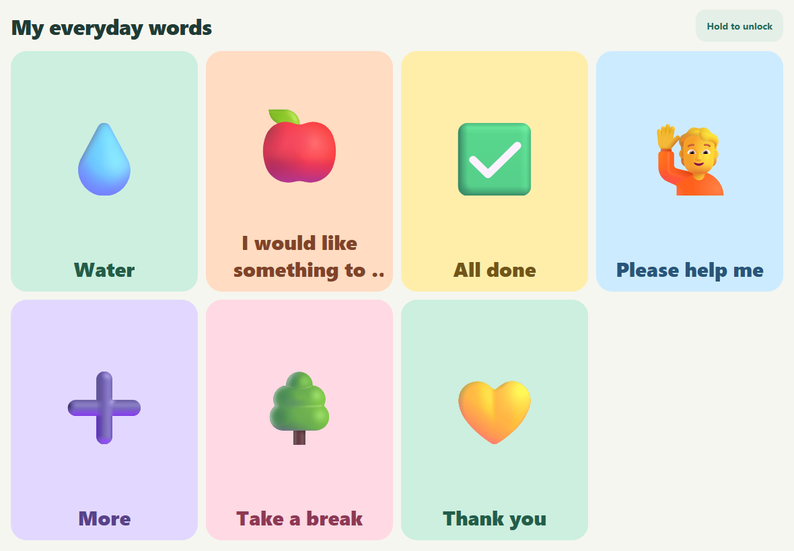
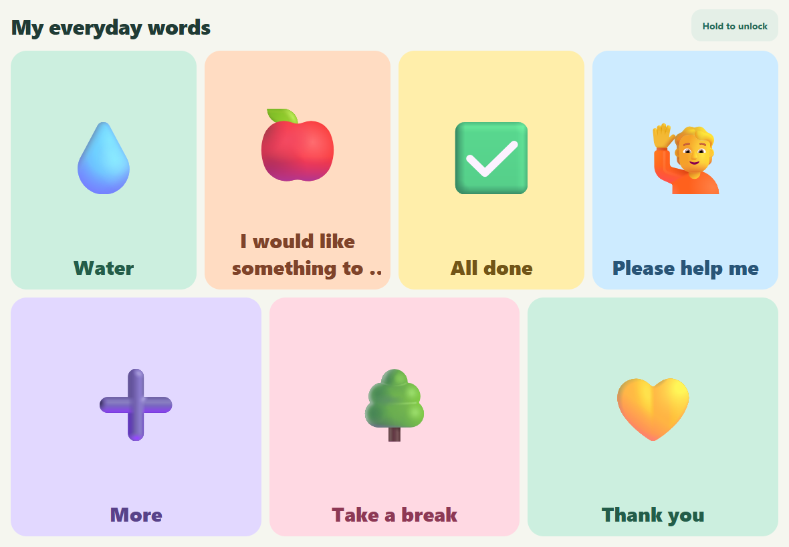
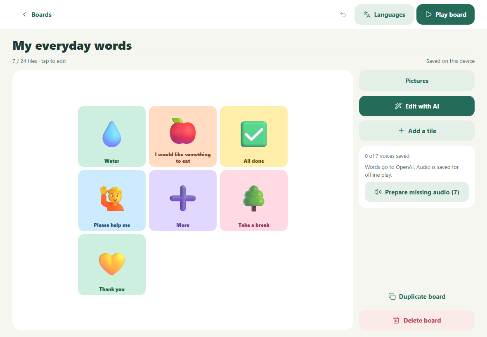
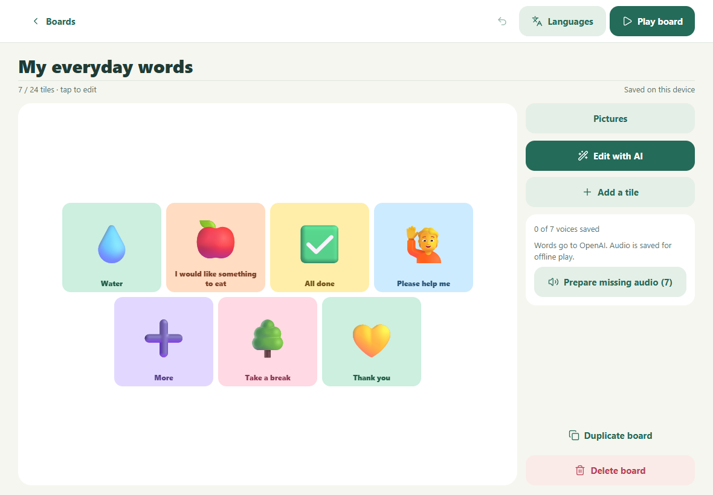
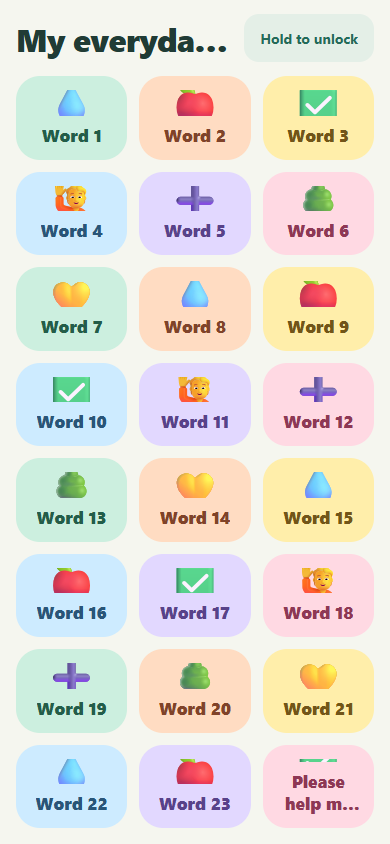
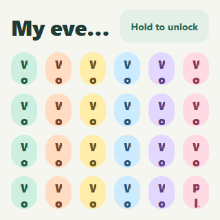
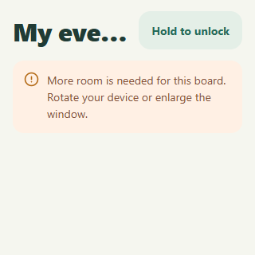

# Issue 31 evidence — balanced storyboard rows

Owner: implementation task `01a11405-db71-76ed-9ec6-44717ef3402a`, coordinated from issue31. This dedicated evidence ref is retained for reviewers for the lifetime of the issue/PR and must not be merged into product history or deleted without coordinated evidence-preservation review.

Current captures: [manifest](ui-final2/manifest.json), [capture harness and exact synthetic fixture](capture-grid.mjs). Before is master `1f0329052bd46b1e953c5adb5ad7e59ba2f2dcc4`; After is `b21d3ba7370c08468b868385ce9df3d875eee799`. Both checkouts were clean. The manifest binds browser/version, clock, capture times, image hashes, full build inventories, running server identity and exact browser-served bundle hashes. [Validation and limitations](validation.json); [complete source scope](source-scope.json).

The current comparison is actual master-to-final app behavior. The earlier ui-preview directory is dirty-source exploration and cannot establish source provenance; ui-final contains the first clean committed capture and is superseded only for capture settling. Those original bytes/identities are preserved, with their exact earlier harnesses. ui-inspect is the diagnostic settled dense-card observation.

## Reproduce

On the designated ZBook, create isolated little-say-before and little-say-grid checkouts at the full SHAs above; npm ci separately in each and npm run build. Place this retained capture-grid.mjs under a sibling records directory, beside those checkouts as in the manifest. Run `node records/capture-grid.mjs ui-final2` only with a new output directory for a new attempt. It uses installed Edge via Playwright, binds loopback7413/7414 to each own Node process and verifies loaded bundle bytes. No external provider, account, production database or real family data is used. Fonts, dimensions, synthetic fixture and interaction state are matched; service workers, speech synthesis and fullscreen behavior are normalized identically and disclosed in validation.json. The local browser suite uses the retained ignored configuration on port7411.

## Observed comparisons

| State | Before | After | Meaning |
| --- | --- | --- | --- |
| Four cards, landscape |  |  | 3+1 becomes2+2, filling both rows. |
| Four cards, portrait |  |  | The good2+2 layout is unchanged. |
| Seven cards, landscape |  |  | Shorter row uses the available width. |
| Seven-card editor |  |  | Compact preview balances4+3 and keeps actions reachable. |
| 24-card phone |  |  | Smaller internal gutters and fitted pictures preserve whole emoji beside long labels. |
| Tiny window |  |  | Infeasible targets get a recovery message; resize recovery is browser-tested. |

222 unit tests and all92 maintained browser tests pass. Android/iOS bundle exports pass. Browser accessible-name/keyboard checks and synthetic speech are distinguished from unexecuted native-device rotation, screen-reader and OS text-scaling checks. The actual GitHub page image-rendering check uses the explicit human waiver; image bytes and pixels are still inspected. Independent QA remains separate.
